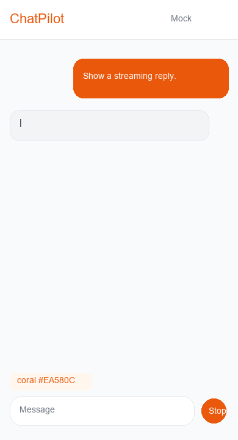
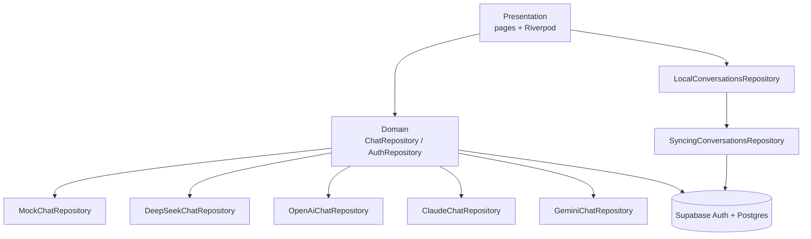

# ChatPilot

[](https://flutter.dev)
[](LICENSE)
[](CHANGELOG.md)

Multi-model AI chat assistant built with **Flutter + Riverpod**.

Coral-orange branded UI with **Mock / DeepSeek / OpenAI (GPT-4o) / Claude 3.5 / Gemini 1.5** streaming backends (paste matching API keys), **device / Whisper / Mock** voice dictation with interrupt, and optional **Supabase** conversation sync.



## Features

- **Conversations** — Local list with SharedPreferences persistence and demo seeds  
- **Personas** — General / Translator / Writer / Engineer / Tutor presets  
- **Multi-model streaming** — Mock typewriter + vendor SSE (DeepSeek, OpenAI, Claude, Gemini)  
- **Voice dictation** — Live partials, commit/cancel interrupt, stop generation mid-stream  
- **Markdown bubbles** — Assistant replies with long-press copy  
- **Settings** — Per-provider API keys, voice engine, account sync, reset demo data  
- **Optional Supabase** — Email auth, RLS, local-first pull/push sync  

## Architecture



Feature-first layout under `lib/features/{chat,conversations,persona,settings,auth,voice}`.

## Quick start

```bash
flutter pub get
flutter run
```

Chrome (Mock chat):

```bash
flutter run -d chrome
```

### API keys

1. Open **Settings**
2. Paste keys for the providers you use (DeepSeek / OpenAI / Anthropic / Google)
3. In a chat, switch model and send

| Model | Provider | Notes |
| :--- | :--- | :--- |
| Mock | Local | Offline demo, no key |
| DeepSeek | DeepSeek | OpenAI-compatible SSE |
| GPT-4o | OpenAI | Chat Completions SSE |
| Claude 3.5 | Anthropic | Messages SSE |
| Gemini 1.5 | Google | `streamGenerateContent` SSE |

Keys stay in SharedPreferences on device — never commit them.

### Voice dictation

| Mode | Behavior |
| :--- | :--- |
| Auto | Device STT → OpenAI Whisper → Mock |
| Device STT | Platform speech recognition with live partials |
| OpenAI Whisper | Record → `/audio/transcriptions` (needs OpenAI key; not on Web) |
| Mock | Offline simulated streaming phrase |

In chat: mic starts listening, stop commits text into the input, Cancel / typing interrupts, and the send button becomes **Stop** while the model streams.

### Supabase (optional)

1. Apply `supabase/migrations/20261110210000_chatpilot_conversations.sql`
2. Disable **Confirm email** for local demos
3. Copy `.vscode/supabase.example.json` → `.vscode/supabase.local.json`
4. Run:

```bash
flutter run --dart-define-from-file=.vscode/supabase.local.json
```

Details: [`supabase/README.md`](supabase/README.md)

## Tests

```bash
dart analyze
flutter test
```

CI runs the same checks on push/PR (see `.github/workflows/ci.yml`).

## Portfolio assets

- Screenshots / demo script: [`docs/screenshots/README.md`](docs/screenshots/README.md)
- Streaming GIF: `docs/screenshots/stream_demo.gif`
- License: [`LICENSE`](LICENSE) (MIT)
- Icon: `assets/icons/chatpilot_icon.png` (coral orange)
- Brand: coral primary `#EA580C` (indigo palette kept as `ThemePalette.indigo` switch)

## Version

`1.0.0+9` — Initial public release.

## Limitations

- Still screenshots / longer demo video may be added under `docs/screenshots/`
- Live models require your own API keys
- Hosted Web demo is optional; voice APIs differ by browser
